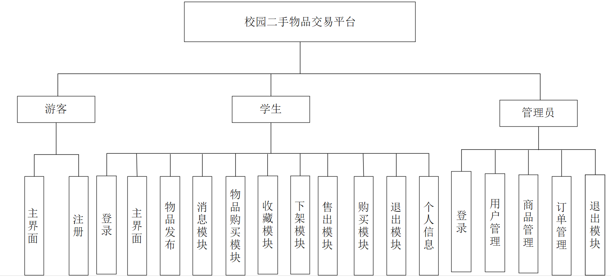
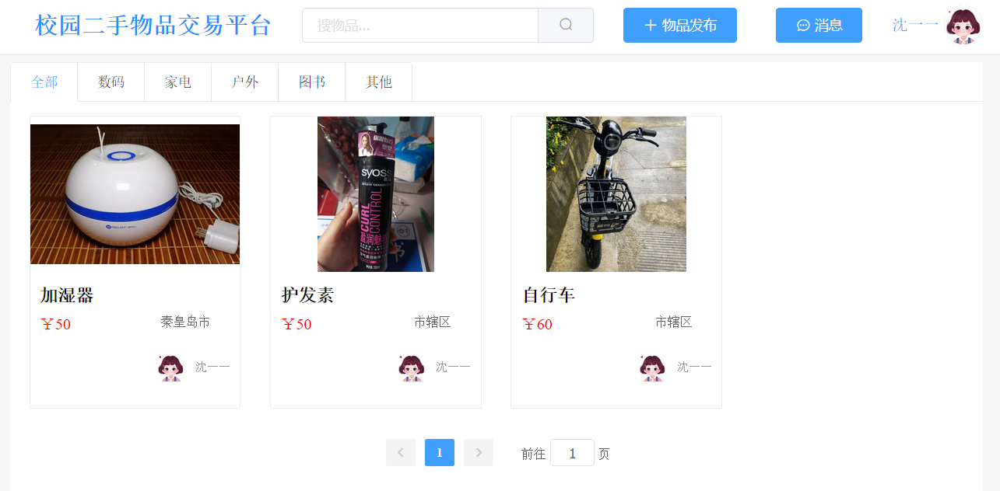
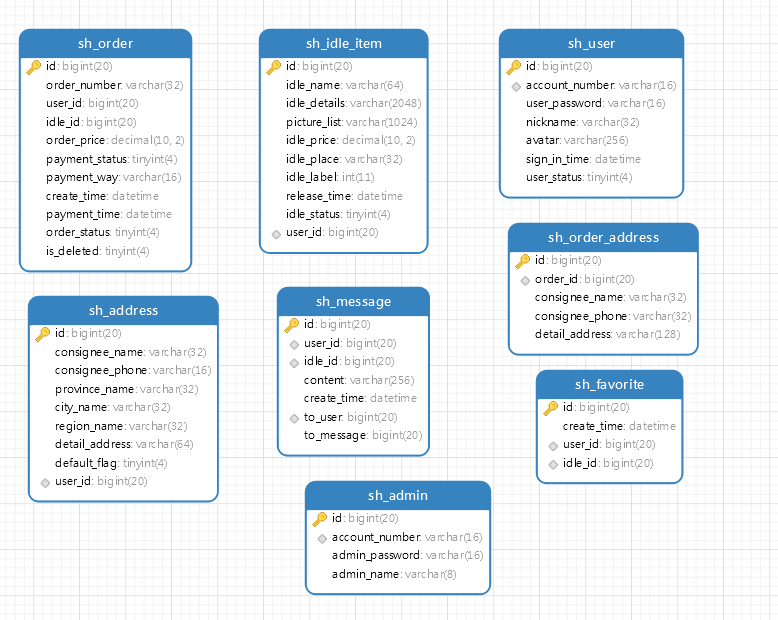

# 校园二手交易平台（Campus Second-hand Trading Platform）

面向高校学生的校园二手闲置物品交易平台。学生可发布闲置物品、按关键词搜索、收藏心仪物品、留言咨询、下单购买；卖家与买家可分别管理「我卖出的 / 我买到的」订单；管理员通过后台对用户、物品、订单进行管理。前后端分离架构，演示数据已脱敏。

## 项目截图

| 界面一 | 界面二 | 界面三 |
| ---- | ---- | ---- |
|  |  |  |

## 功能总览

### 用户端

- 注册 / 登录（Cookie 会话保持）
- 发布闲置物品（多图上传）、物品详情展示
- 关键词分页搜索、标签分类浏览、收藏
- 留言咨询 / 卖家回复
- 下单购买（模拟支付宝支付）
- **未支付订单超时自动取消**（JDK DelayQueue 延迟队列实现）
- 订单双视角管理：我买到的 / 我卖出的（含发货、确认收货流程）
- 收货地址管理、个人中心

### 管理后台

- 管理员登录
- 用户管理、闲置物品管理（审核 / 下架）、订单管理

## 技术栈

| 模块 | 技术 |
| ---- | ---- |
| 后端 | Spring Boot 2.4、MyBatis、MySQL 8.0、FastJSON、Validation |
| 前端 | Vue 2.6、ElementUI、Vue Router、Axios（Vue CLI 3 构建） |
| 其他 | 全局异常处理、统一响应体（R）、自定义分页封装（PageVo）、CORS 跨域 |

## 目录结构

```
campus-second-hand-trading
├── school-trade-backend/               # Spring Boot 后端
│   └── src/main/java/com/shanzhu/st/
│       ├── controller/                 # 接口层（用户/物品/订单/收藏/留言/地址/管理员）
│       ├── service/                    # 业务层
│       ├── mapper/                     # MyBatis 数据访问层
│       ├── entity/ vo/ enums/          # 实体 / 视图 / 枚举
│       ├── config/                     # 跨域配置
│       ├── Handler/                    # 全局异常处理
│       └── utils/                      # 延迟队列订单任务（DelayQueue）、ID 生成
├── school-trade-frontend/              # Vue2 + ElementUI 前端
│   └── src/                            # api / components / router / utils
├── pic/                                # 演示商品图片（被数据库演示数据引用）
├── docs/images/                        # 运行截图
└── DB_School_Trade.sql                 # 数据库初始化脚本（含演示数据）
```

## 快速开始

### 环境要求

- JDK 1.8+、Maven 3.x、MySQL 8.0、Node.js 12+

### 1. 初始化数据库

```sql
source DB_School_Trade.sql;
```

### 2. 启动后端

修改 `school-trade-backend/src/main/resources/application.yml`：

- 数据库账号密码
- `userFilePath`：商品图片存储目录，指向本仓库的 `pic` 目录（如 `E:/campus-second-hand-trading/pic`）

```bash
cd school-trade-backend
mvn spring-boot:run
# 服务地址: http://localhost:8080
```

### 3. 启动前端

```bash
cd school-trade-frontend
npm install
npm run serve
# 访问 http://localhost:8080（如与后端端口冲突，修改 vue.config.js 的 devServer.port，
# 并同步修改后端 WebMvcConfig 中的 allowedOrigins 跨域白名单）
```

### 默认账号

| 角色 | 账号 | 密码 |
| ---- | ---- | ---- |
| 管理员（后台） | admin | 123456 |
| 用户 | 18777777777 / 18888888888 | 123456 |

## 注意事项

- 仓库演示数据与图片均已脱敏，不包含任何真实个人信息
- 项目答辩 PPT 因包含成员姓名，出于隐私保护未包含在仓库中
- `application.yml` 中的图片路径、数据库密码为本地开发配置，部署时请修改

## License

[MIT](./LICENSE)
